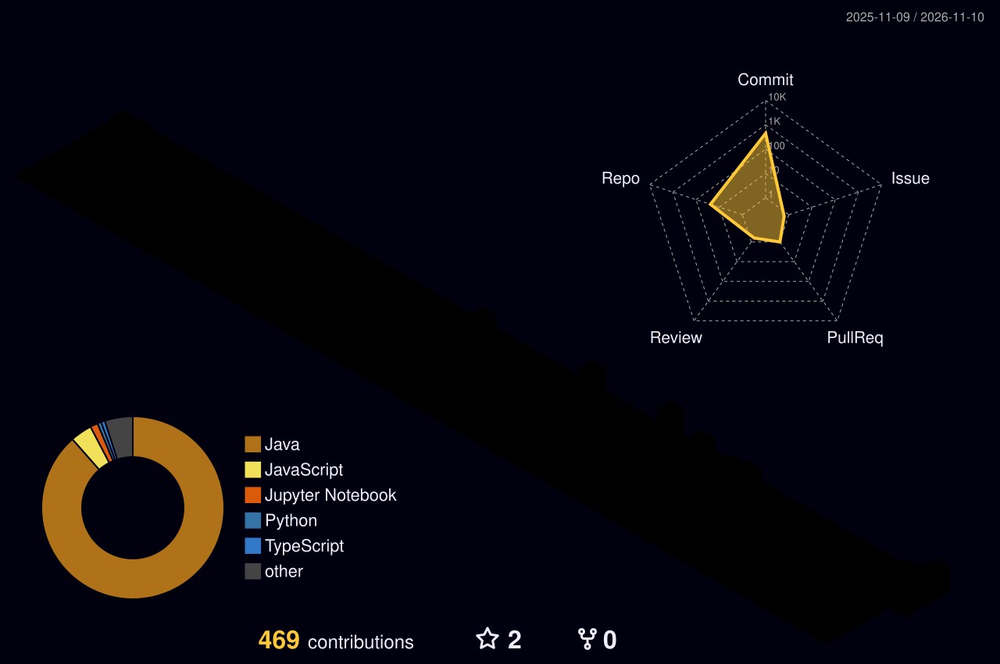

<!-- ==================== GARGI PADATE | DASHBOARD README ==================== -->

<!-- 1. HERO BANNER -->
<p align="center">
  
</p>

<p align="center">
  
</p>

<p align="center">
  
  
  
  
</p>

---

<!-- 2. ABOUT SECTIONS (WHO I AM / WHAT I DO / VISION / BEYOND CODE) -->


Hey, I'm **Gargi** — an Information Technology student at **Vishwakarma Institute of Technology, Pune**. I work at the intersection of **AI, computer vision, robotics and full-stack development**, and I love making intelligent systems that actually work in the real world.

I'm part of the team that secured **AIR 6 at ABU Robocon 2026** 🏆. I learn by building, breaking, debugging and rebuilding.


I build software and AI-powered tools that solve real problems, from autonomous robot navigation to deep-learning applications and complete web products — and I like understanding how things work from first principles.


My goal is to build technology that is **useful, accessible and human-first** — shipping AI products that real people use, and robots that do things which seemed impossible until they finally worked.


Lo-fi and synthwave on repeat, Hans Zimmer for late-night debugging, and a never-ending list of "what if I built…" ideas. 🎧

---

<!-- 3. SOCIAL DASHBOARD -->
<div align="center">
<table border="0" cellspacing="0" cellpadding="8">
  <tr>
    <th>LinkedIn</th>
    <th>GitHub</th>
    <th>Gmail</th>
    <th>LeetCode</th>
    <th>Kaggle</th>
    <th>Portfolio</th>
  </tr>
  <tr>
    <td align="center"><br><a href="https://www.linkedin.com/in/gargi-p-049865329/" title="LinkedIn"></a><br><br></td>
    <td align="center"><br><a href="https://github.com/Gargi4-git" title="GitHub"></a><br><br></td>
    <td align="center"><br><a href="mailto:gargipadate57@gmail.com" title="Gmail"></a><br><br></td>
    <!-- TODO: replace YOUR_LEETCODE_USERNAME -->
    <td align="center"><br><a href="https://leetcode.com/u/YOUR_LEETCODE_USERNAME" title="LeetCode"></a><br><br></td>
    <!-- TODO: replace YOUR_KAGGLE_USERNAME -->
    <td align="center"><br><a href="https://www.kaggle.com/YOUR_KAGGLE_USERNAME" title="Kaggle"></a><br><br></td>
    <!-- TODO: replace with your portfolio link -->
    <td align="center"><br><a href="https://YOUR-PORTFOLIO.vercel.app" title="Portfolio"></a><br><br></td>
  </tr>
</table>
</div>

---

<!-- 4. 3D CONTRIBUTION PROFILE (generated by the GitHub Action in the setup notes) -->
<p align="center">
  
</p>

<!-- 5. LIVE STATS -->
<div align="center">
  
  
  <br/><br/>
  
</div>

---

<!-- 6. SKILL SET -->


<div align="center">
  <table width="100%">
    <!-- ROW 1: Languages & Web -->
    <tr>
      <td align="center" width="10%"><br>C++</td>
      <td align="center" width="10%"><br>C</td>
      <td align="center" width="10%"><br>Java</td>
      <td align="center" width="10%"><br>Python</td>
      <td align="center" width="10%"><br>JS</td>
      <td align="center" width="10%"><br>TS</td>
      <td align="center" width="10%"><br>Dart</td>
      <td align="center" width="10%"><br>HTML</td>
      <td align="center" width="10%"><br>CSS</td>
      <td align="center" width="10%"><br>React</td>
    </tr>
    <!-- ROW 2: Frameworks & Databases -->
    <tr>
      <td align="center"><br>Next.js</td>
      <td align="center"><br>Tailwind</td>
      <td align="center"><br>Flutter</td>
      <td align="center"><br>Node</td>
      <td align="center"><br>FastAPI</td>
      <td align="center"><br>Flask</td>
      <td align="center"><br>Firebase</td>
      <td align="center"><br>Supabase</td>
      <td align="center"><br>MySQL</td>
      <td align="center"><br>MongoDB</td>
    </tr>
    <!-- ROW 3: AI / ML -->
    <tr>
      <td align="center"><br>NumPy</td>
      <td align="center"><br>Pandas</td>
      <td align="center"><br>Matplotlib</td>
      <td align="center"><br>Sklearn</td>
      <td align="center"><br>TensorFlow</td>
      <td align="center"><br>PyTorch</td>
      <td align="center"><br>OpenCV</td>
      <td align="center"><br>HFace</td>
      <td align="center"><br>Streamlit</td>
      <td align="center"><br>Jupyter</td>
    </tr>
    <!-- ROW 4: Robotics & Tools -->
    <tr>
      <td align="center"><br>ROS</td>
      <td align="center"><br>Arduino</td>
      <td align="center"><br>RaspberryPi</td>
      <td align="center"><br>Linux</td>
      <td align="center"><br>Docker</td>
      <td align="center"><br>Git</td>
      <td align="center"><br>GitHub</td>
      <td align="center"><br>Postman</td>
      <td align="center"><br>VS Code</td>
      <td align="center"><br>Figma</td>
    </tr>
  </table>
</div>

---

<!-- 7. FEATURED PROJECTS -->


<table>
<tr>
<td width="50%" valign="top">

### 🤖 ABU Robocon 2026
**AIR 6 | Autonomous Robotics**

Autonomous navigation, robot control, sensor integration and hardware-software communication.

`ROS2` `OpenCV` `Python` `ESP32`

</td>
<td width="50%" valign="top">

### 🧬 Skin Disease Detection
**AI-powered image analysis**

Deep-learning app that classifies skin conditions from images through a simple web interface.

`TensorFlow` `Flask` `React` `Python`

</td>
</tr>
<tr>
<td width="50%" valign="top">

### 🌱 CarbonMine
**Carbon footprint tracking**

Web app for tracking carbon emissions and presenting environmental data interactively.

`React` `TypeScript` `Firebase`

</td>
<td width="50%" valign="top">

### 👻 GhostGap AI
**AI for creator opportunities**

AI-powered app that helps creators discover relevant opportunities.

`Next.js` `FastAPI` `Gemini AI`

</td>
</tr>
</table>

<!-- Optional: pinned repo cards (uncomment and change repo names)
<p align="center">
  <a href="https://github.com/Gargi4-git/REPO_NAME"></a>
</p>
-->

---

<!-- 8. ACHIEVEMENTS -->


| 🏆 Achievement | 📍 Where | 📅 Year |
|---|---|---|
| **AIR 6** — ABU Robocon (India) | National | 2026 |
| *Add hackathon / competition here* | — | — |
| *Add certification here* | — | — |

---

<!-- 9. CURRENTLY -->


```yaml
🔭 working_on:    "AI + computer vision projects"
🌱 learning:      "Cloud, DevOps & MLOps"
🤝 open_to:       "Collaborations, internships, open-source"
💬 ask_me_about:  "Robotics, ROS2, OpenCV, CNNs, React"
⚡ fun_fact:      "My code has character development arcs"
```

---

<!-- 10. 2026 VISION BOARD -->


- [x] Achieve AIR 6 at ABU Robocon 2026 🏆
- [ ] Solve 500+ LeetCode problems
- [ ] Make meaningful open-source contributions
- [ ] Ship an AI project that real people use
- [ ] Get better at cloud computing and DevOps
- [ ] Keep learning, experimenting, and creating

---

<!-- 11. ACTIVITY GRAPH + SNAKE -->
<div align="center">
  
  <br/><br/>
  
</div>

<picture>
  <source media="(prefers-color-scheme: dark)" srcset="https://raw.githubusercontent.com/Gargi4-git/Gargi4-git/output/github-contribution-grid-snake-dark.svg">
  <source media="(prefers-color-scheme: light)" srcset="https://raw.githubusercontent.com/Gargi4-git/Gargi4-git/output/github-contribution-grid-snake.svg">
  
</picture>

---

<!-- 12. QUOTE + FOOTER -->
<div align="center">


<br/>

`lo-fi` · `synthwave` · `Hans Zimmer` · `Interstellar OST`

### *building the future, one pretty little commit at a time.* 💗

<a href="mailto:gargipadate57@gmail.com"></a>
<a href="https://github.com/Gargi4-git"></a>
<a href="https://www.linkedin.com/in/gargi-p-049865329/"></a>


</div>

<!-- ==================== END OF README ==================== -->
