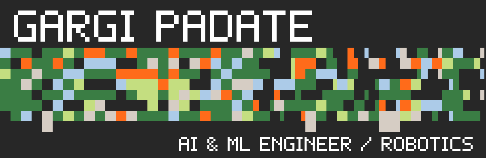
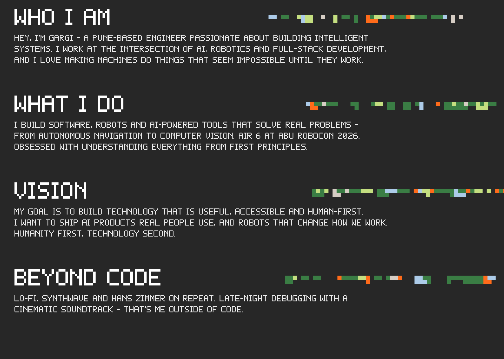
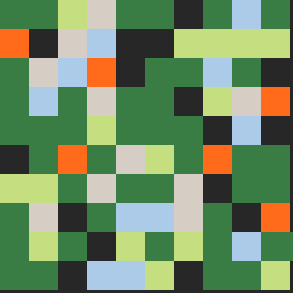
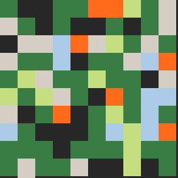
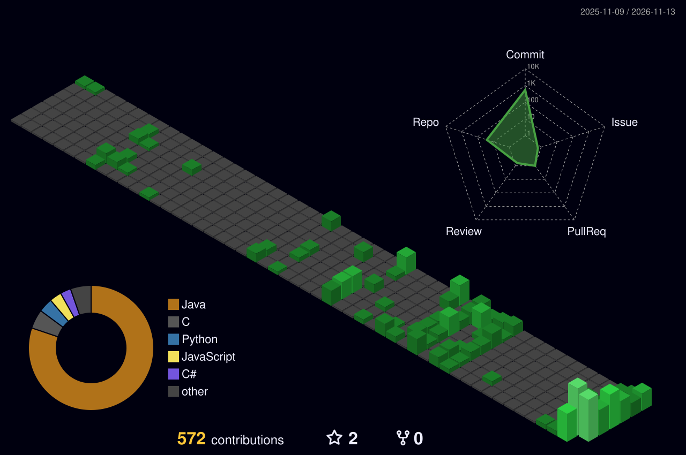
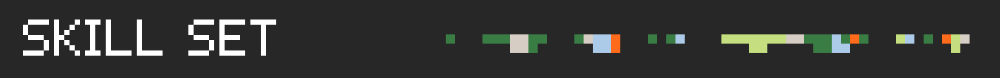
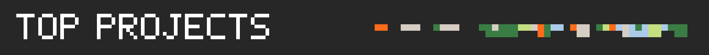
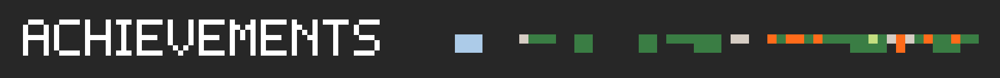
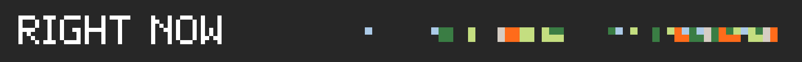
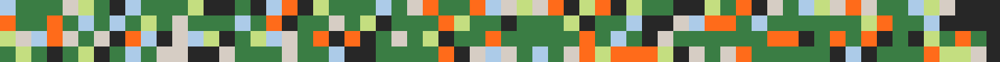

<p align="center">
  
</p>

<p align="center">
  
</p>

<div align="center">
<table border="0" cellspacing="0" cellpadding="0">
  <tr>
    <td width="200" align="center">
      
    </td>
    <td align="center">
      <table border="0" cellspacing="0" cellpadding="8">
        <tr>
          <th>LinkedIn</th>
          <th>GitHub</th>
          <th>Gmail</th>
          <th>LeetCode</th>
          <th>Kaggle</th>
          <th>Website</th>
        </tr>
        <tr>
          <td align="center"><br><a href="https://www.linkedin.com/in/gargi-p-049865329/" title="LinkedIn"></a><br><br></td>
          <td align="center"><br><a href="https://github.com/Gargi4-git" title="GitHub"></a><br><br></td>
          <td align="center"><br><a href="mailto:gargipadate57@gmail.com" title="Gmail"></a><br><br></td>
          <!-- TODO: put your LeetCode username -->
          <td align="center"><br><a href="https://leetcode.com/u/YOUR_LEETCODE_USERNAME" title="LeetCode"></a><br><br></td>
          <!-- TODO: put your Kaggle username -->
          <td align="center"><br><a href="https://www.kaggle.com/YOUR_KAGGLE_USERNAME" title="Kaggle"></a><br><br></td>
          <!-- TODO: put your portfolio link -->
          <td align="center"><br><a href="https://YOUR-PORTFOLIO.vercel.app" title="Website"></a><br><br></td>
        </tr>
      </table>
    </td>
    <td width="200" align="center">
      
    </td>
  </tr>
</table>
</div>



<p align="center">
  
</p>

<div align="center">
  <table width="100%">
    <tr>
      <td align="center" width="10%"><br>C++</td>
      <td align="center" width="10%"><br>C</td>
      <td align="center" width="10%"><br>Java</td>
      <td align="center" width="10%"><br>Python</td>
      <td align="center" width="10%"><br>JS</td>
      <td align="center" width="10%"><br>TS</td>
      <td align="center" width="10%"><br>HTML</td>
      <td align="center" width="10%"><br>CSS</td>
      <td align="center" width="10%"><br>React</td>
      <td align="center" width="10%"><br>Next.js</td>
    </tr>
    <tr>
      <td align="center"><br>Tailwind</td>
      <td align="center"><br>Flutter</td>
      <td align="center"><br>Node</td>
      <td align="center"><br>FastAPI</td>
      <td align="center"><br>Flask</td>
      <td align="center"><br>Firebase</td>
      <td align="center"><br>Supabase</td>
      <td align="center"><br>MySQL</td>
      <td align="center"><br>MongoDB</td>
      <td align="center"><br>Figma</td>
    </tr>
    <tr>
      <td align="center"><br>NumPy</td>
      <td align="center"><br>Pandas</td>
      <td align="center"><br>Matplot</td>
      <td align="center"><br>Sklearn</td>
      <td align="center"><br>TensorFlow</td>
      <td align="center"><br>PyTorch</td>
      <td align="center"><br>OpenCV</td>
      <td align="center"><br>HFace</td>
      <td align="center"><br>Streamlit</td>
      <td align="center"><br>Jupyter</td>
    </tr>
    <tr>
      <td align="center"><br>ROS</td>
      <td align="center"><br>Arduino</td>
      <td align="center"><br>RPi</td>
      <td align="center"><br>Linux</td>
      <td align="center"><br>Docker</td>
      <td align="center"><br>Git</td>
      <td align="center"><br>GitHub</td>
      <td align="center"><br>Postman</td>
      <td align="center"><br>VS Code</td>
      <td align="center"><br>AWS</td>
    </tr>
  </table>
</div>

<p align="center">
  
</p>

<table>
<tr>
<td width="50%" valign="top">

### 🤖 ABU Robocon 2026
**AIR 6 | Autonomous Robotics**

Autonomous navigation, robot control, sensor integration and hardware-software communication.

`ROS2` `OpenCV` `Python` `ESP32`

</td>
<td width="50%" valign="top">

### 🧬 Skin Disease Detection
**AI-powered image analysis**

Deep-learning app that classifies skin conditions from images through a web interface.

`TensorFlow` `Flask` `React` `Python`

</td>
</tr>
<tr>
<td width="50%" valign="top">

### 🌱 CarbonMine
**Carbon footprint tracking**

Web app for tracking carbon emissions and presenting environmental data interactively.

`React` `TypeScript` `Firebase`

</td>
<td width="50%" valign="top">

### 👻 GhostGap AI
**AI for creator opportunities**

AI-powered app that helps creators discover relevant opportunities.

`Next.js` `FastAPI` `Gemini AI`

</td>
</tr>
</table>

<p align="center">
  
</p>

| 🏆 Achievement | 📍 Level | 📅 Year |
|---|---|---|
| **AIR 6** - ABU Robocon (India) | National | 2026 |
| *Add hackathon / certification here* | - | - |

<p align="center">
  
</p>

```yaml
working_on:   "AI + computer vision projects"
learning:     "Cloud, DevOps & MLOps"
open_to:      "Collaborations, internships, open-source"
ask_me_about: "Robotics, ROS2, OpenCV, CNNs, React"
```

<div align="center">
  
  
</div>

<picture>
  <source media="(prefers-color-scheme: dark)" srcset="https://raw.githubusercontent.com/Gargi4-git/Gargi4-git/output/github-contribution-grid-snake-dark.svg">
  <source media="(prefers-color-scheme: light)" srcset="https://raw.githubusercontent.com/Gargi4-git/Gargi4-git/output/github-contribution-grid-snake.svg">
  
</picture>

<p align="center">
  
</p>
